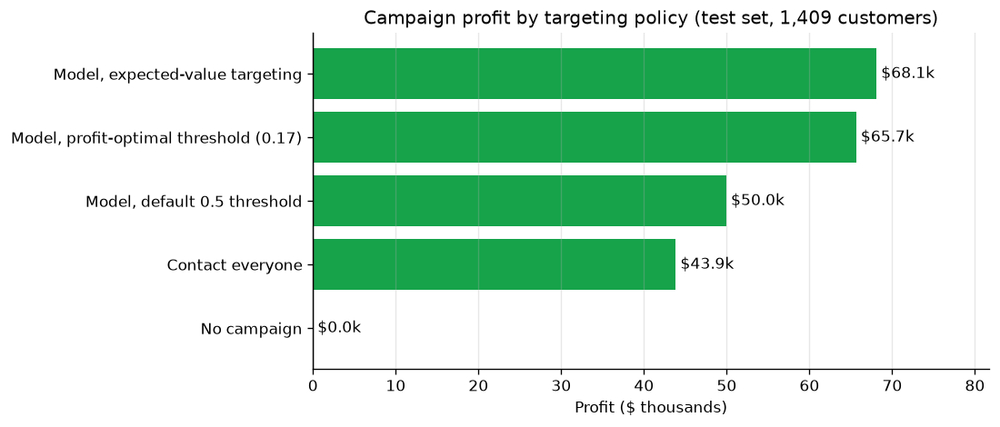
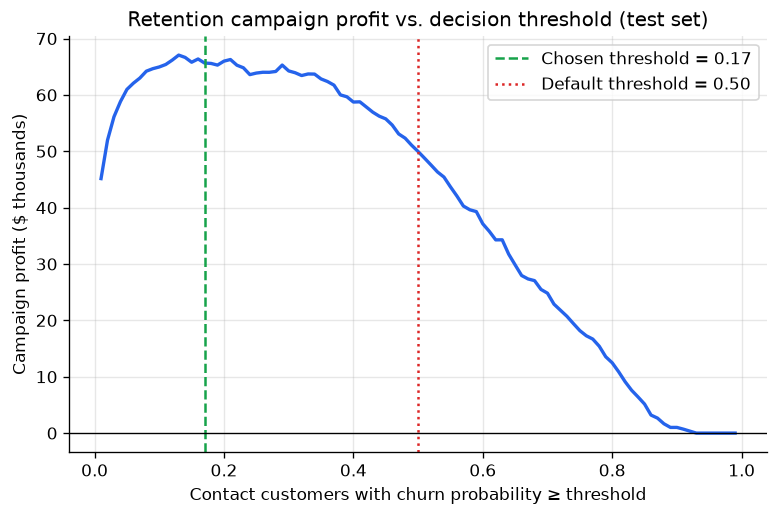
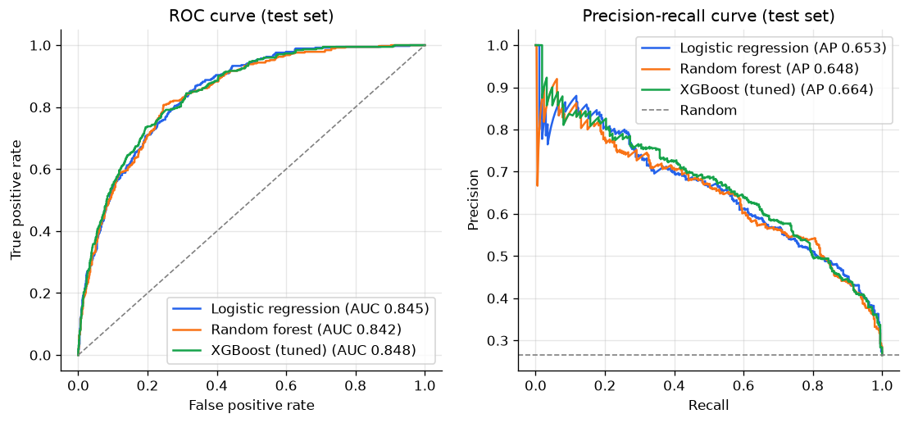
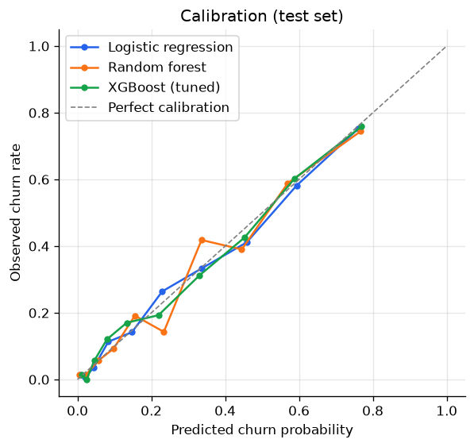
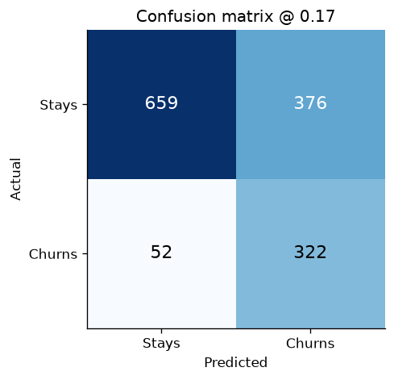
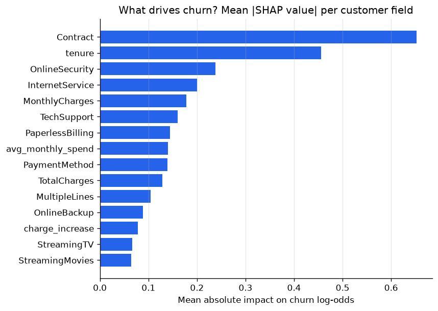

# Customer Churn Prediction

[](https://github.com/fareszid/customer-churn-prediction/actions/workflows/ci.yml)

[](LICENSE)

Predicts which telecom customers are about to leave, explains each prediction with SHAP, and
picks the customers who should get a retention offer so that the campaign makes the most money.
The model is served by a FastAPI service that runs in Docker.

**Result:** on 1,409 held-out customers, targeting with the model earns **$68.1k** from the
retention campaign, against **$43.9k** for contacting everyone (+55% profit, 54% fewer contacts)
and **$50.0k** for the usual "probability > 0.5" rule (+36%).



## The problem

The operator loses 26.5% of its customers, and they account for 30.5% of monthly recurring
revenue. The retention team can offer discounts, but every offer costs money, so the question is
which customers to contact to make the campaign as profitable as possible.

The campaign assumptions live in [`config.py`](src/churn/config.py):

| Assumption | Value |
|---|---|
| Cost per contacted customer (outreach + discount) | $50 |
| Share of would-be churners kept by the offer | 35% |
| Revenue kept when a churner stays | 12 × monthly bill |

## Approach

1. **EDA** in [`notebooks/01_exploratory_analysis.ipynb`](notebooks/01_exploratory_analysis.ipynb):
   data quality, churn by segment, tenure and pricing effects.
2. **Features**: number of services, average past bill, recent price change, new-customer and
   auto-payment flags. They are computed inside the scikit-learn pipeline, so the API takes raw
   records and runs exactly the same code as training.
3. **Models**: logistic regression (baseline), random forest, and XGBoost tuned with Optuna,
   all compared on the same stratified 5-fold CV splits. The best CV PR-AUC wins.
4. **Decision threshold**: chosen to maximise campaign profit on out-of-fold predictions, so the
   test set is only used once, for the final numbers.
5. **Explanations**: SHAP values summed back to the original fields (all `Contract_*` columns
   become `Contract`), for the whole test set and for every API prediction.
6. **Serving**: FastAPI with Pydantic validation, a batch endpoint, a Docker image, and a CI job
   that trains a model, builds the image and calls the running container.

## Results

Cross-validation on the training set (5 folds, mean ± std):

| Model | ROC-AUC | PR-AUC | Log loss | Brier |
|---|---|---|---|---|
| Logistic regression | 0.848 ± 0.013 | 0.662 ± 0.017 | 0.414 | 0.134 |
| Random forest | 0.844 ± 0.009 | 0.657 ± 0.025 | 0.419 | 0.136 |
| **XGBoost (tuned)** | **0.850 ± 0.014** | **0.673 ± 0.022** | **0.411** | **0.133** |

Test set (1,409 customers):

| Model | ROC-AUC | PR-AUC |
|---|---|---|
| Logistic regression | 0.846 | 0.653 |
| Random forest | 0.842 | 0.648 |
| **XGBoost (selected)** | **0.848** | **0.664** |

At the profit-optimal threshold of 0.17 the model reaches 86% recall (322 of 374 churners) with
46% precision.

| Targeting policy | Contacted | Churners reached | Profit |
|---|---|---|---|
| No campaign | 0 | 0% | $0 |
| Contact everyone | 1,409 | 100% | $43.9k |
| Model, 0.5 threshold | 297 | 53% | $50.0k |
| Model, profit-optimal threshold (0.17) | 698 | 86% | $65.7k |
| **Model, expected-value targeting** | **648** | **82%** | **$68.1k** |

Expected-value targeting contacts a customer only when
`P(churn) × save rate × customer value > offer cost`, so high-paying customers are contacted at a
lower churn probability than low-paying ones.

<table>
<tr>
<td></td>
<td></td>
</tr>
<tr>
<td></td>
<td></td>
</tr>
</table>

XGBoost beats plain logistic regression by only ~0.01 PR-AUC, which is within one standard
deviation across folds. A few strong categorical features carry most of the signal, so the
decision rule matters far more than the model here: going from the 0.5 threshold to profit-based
targeting adds 36% profit, going from logistic regression to XGBoost adds about 1%.

## What drives churn



- **Contract type** is the strongest driver: month-to-month customers churn at 42.7% vs. 2.8% on
  two-year contracts. Moving customers to annual contracts is the main lever.
- **Tenure**: 53% of customers leave in their first 6 months, so onboarding matters.
- **No online security or tech support**, and **fiber optic** internet, raise the risk. Support
  services are a good thing to include in the offer, and fiber pricing deserves a look.
- **Electronic check** payers churn at 45% vs. ~16% with automatic payments.

## Prediction API

```bash
make train          # or: python -m churn.train --trials 60
make serve          # Swagger UI on http://localhost:8000/docs
```

```bash
curl -X POST localhost:8000/predict -H "Content-Type: application/json" -d '{
  "gender": "Female", "SeniorCitizen": 0, "Partner": "Yes", "Dependents": "No",
  "tenure": 3, "PhoneService": "Yes", "MultipleLines": "No", "InternetService": "Fiber optic",
  "OnlineSecurity": "No", "OnlineBackup": "No", "DeviceProtection": "No", "TechSupport": "No",
  "StreamingTV": "Yes", "StreamingMovies": "Yes", "Contract": "Month-to-month",
  "PaperlessBilling": "Yes", "PaymentMethod": "Electronic check",
  "MonthlyCharges": 99.65, "TotalCharges": 298.95
}'
```

```json
{
  "churn_probability": 0.8445,
  "risk_level": "high",
  "contact_customer": true,
  "threshold": 0.17,
  "top_factors": [
    {"feature": "tenure", "value": 3, "impact": 0.7375},
    {"feature": "Contract", "value": "Month-to-month", "impact": 0.4836},
    {"feature": "MonthlyCharges", "value": 99.65, "impact": 0.3128},
    {"feature": "OnlineSecurity", "value": "No", "impact": 0.268},
    {"feature": "InternetService", "value": "Fiber optic", "impact": 0.2565}
  ]
}
```

| Endpoint | Description |
|---|---|
| `GET /health` | Liveness check |
| `GET /model` | Model name, training date, threshold, test metrics, library versions |
| `POST /predict` | Score one customer, with SHAP explanation |
| `POST /predict/batch` | Score up to 1,000 customers |

Invalid inputs (for example `"Contract": "Weekly"`) get an HTTP 422.

With Docker:

```bash
make train && make docker-build && make docker-run
```

## Run it

```bash
git clone https://github.com/fareszid/customer-churn-prediction.git
cd customer-churn-prediction
python -m venv .venv && source .venv/bin/activate
make install        # pip install -e ".[dev]"
make train          # downloads the data, tunes, trains, writes reports/ and models/
make test           # 19 tests: data, features, business logic, training, API
make notebook       # re-runs the EDA notebook
```

Training takes about a minute on a laptop. The tests use a synthetic dataset with the real
schema, so they run offline in about 10 seconds.

## Project structure

```
├── src/churn/
│   ├── config.py        # paths, constants, campaign assumptions
│   ├── data.py          # download + cleaning
│   ├── features.py      # feature engineering + preprocessing pipeline
│   ├── business.py      # profit, threshold search, expected-value targeting
│   ├── train.py         # tuning, CV comparison, selection, final evaluation
│   ├── evaluate.py      # metrics and figures
│   ├── explain.py       # SHAP grouped by original field
│   ├── predict.py       # model loading + scoring
│   ├── schemas.py       # request / response models
│   └── api.py           # FastAPI app
├── tests/
├── notebooks/           # EDA notebook
├── reports/             # metrics.json and figures written by training
├── Dockerfile
└── Makefile
```

## Design choices

- **PR-AUC to select the model.** With 26.5% positives, accuracy is misleading (predicting "no
  churn" for everyone is 73.5% accurate). PR-AUC measures how well churners are ranked first.
- **Threshold picked on out-of-fold predictions.** Picking it on the test set would leak and
  overstate the profit.
- **No re-weighting or SMOTE.** The probabilities stay calibrated (see the calibration plot),
  which matters because they go straight into the expected-value calculation.
- **One pipeline.** Feature engineering is a `FunctionTransformer`, so training, the API and the
  Docker image run the same code.

## Limitations and next steps

- The campaign numbers are assumptions. In practice the save rate should come from an A/B test,
  and an uplift model would target customers who can be persuaded, not just those at risk.
- The data is a single snapshot. A production system would retrain regularly, monitor drift
  (e.g. with Evidently) and track experiments (e.g. with MLflow).
- Survival analysis could predict *when* a customer will leave, not just whether.

## Data

[IBM Telco Customer Churn](https://github.com/IBM/telco-customer-churn-on-icp4d) sample dataset
(7,043 customers, 21 fields). It is downloaded at runtime and not stored in this repository.
